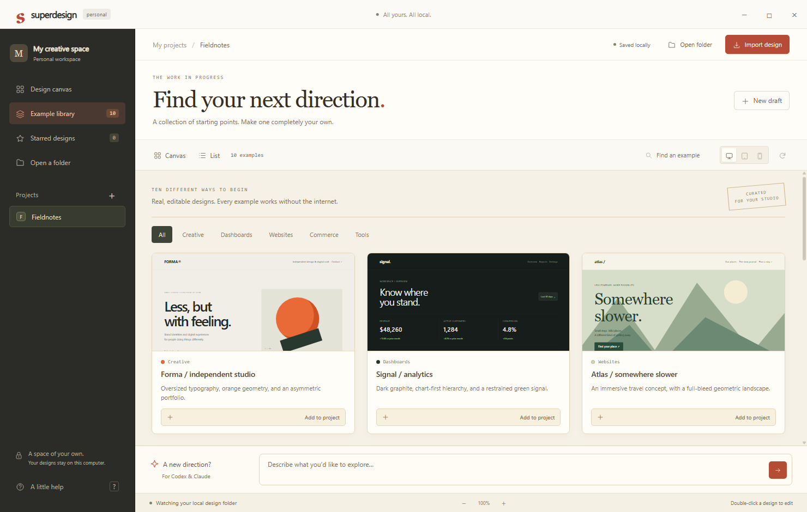
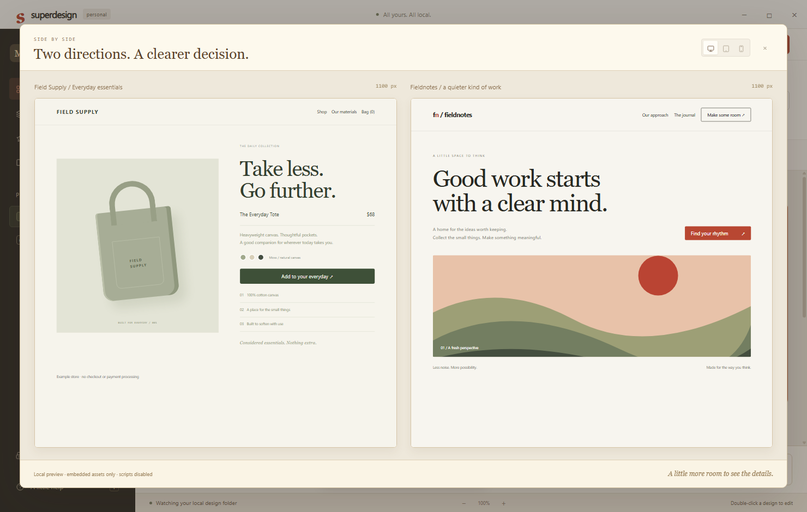

# Superdesign Personal

A standalone Windows design canvas inspired by the original Superdesign IDE extension. No Superdesign account, hosted canvas or provider SDK is required. The canvas and previews make no outbound requests. Assistant clients launched explicitly by you use their own accounts and network connections.

Run `npm install`, `npx install-electron`, then `npm start` (Node 22.12 or newer). Run `npm run package` to build the portable Windows application under `release/Superdesign-Personal-win32-x64/`. Launch `Superdesign-Personal.exe` from that folder; keep its accompanying files together.

The app stores projects as normal local folders under Documents/Superdesign Personal. Open another project folder to watch its `.superdesign/design_iterations` directory. It imports HTML/SVG copies, watches external edits, creates local starter templates, edits source with preview, duplicates iterations, exports original source, and saves project briefs for Codex, ChatGPT, Claude or Gemini. Previous editor saves are retained in `.superdesign/history`. Drafts modified externally are protected from stale editor overwrites.

Codex and Claude can use the local `superdesign` skill to author designs in the watched folder. The app does not run an AI model or pretend its starter templates are AI generation. A coding assistant's own model/network requirements are separate from this local app.

Previews disable scripts and remote resources. Use self-contained HTML with inline CSS, SVG and data images; external assets are not downloaded or embedded automatically. Imported source and exported files are preserved without the preview restrictions. The desktop application blocks HTTP, HTTPS and WebSocket requests, denies permissions, and does not expose Node APIs to designs.

## Attribution and source

Original repository: https://github.com/superdesigndev/superdesign, pinned at `49e2b9dd9615c6dae936b326b1ddb85d4f1d6f19`, by AI Jason and JackJack. The original source is retained in this checkout. This standalone edition reimplements its local file-canvas workflow; it does not run the original VS Code host or provider integrations. No Enterprise-marked source was used. The original license is preserved in `../LICENSE` and bundled as `LICENSE.upstream.txt`; this edition's source is provided under AGPL-3.0-only. It is a personal adaptation, not an official Superdesign product.

DSI design workflow for version 0.2: Design Taste, live source pinned at `6c47298b719270aff38978b3545948b5b95a0960`. The original 0.1 build used the explicitly bundled workflow at `73743fc9eb9b51667f4a8698f195841d6915249a` plus maintenance overlay `dsi-0.1.23`. REA static inspection covered the original extension and canvas entrypoints; it did not claim complete runtime reconstruction. App runtime validation is recorded separately in evidence.

## Personal Studio 0.2

The refreshed interface keeps the paper-and-red identity and adds a dark navigation rail, readable controls, and a docked brief composer that does not cover drafts.

- Ten self-contained example designs: Fieldnotes website and dashboard, Forma studio portfolio, Signal analytics, Atlas travel, Field Supply commerce, Sprint planning, Pulse music player, Gather restaurant, and Margin journal. Preview any example, filter by category, and add a fresh editable copy to the current project.
- Select two drafts with their comparison checkboxes and open a side-by-side view. Focused previews and comparisons support desktop, tablet and mobile widths.
- Star drafts, filter to favorites, switch between canvas and list, and sort by name or recent edits.
- Project selection, viewport, zoom, view mode and sorting persist across restarts. Project display names can be changed without moving folders. Favorites are stored separately from draft source.
- Ctrl+N creates a draft, Ctrl+Shift+N creates a project, Ctrl+F finds a design, and Ctrl+S saves editor changes.

Existing 0.1 project registries and design files are retained. The app never inserts examples into an existing project until the user chooses Add to project. The previous installed application can remain alongside this version for rollback.

## Validation

`npm test` exercises persistence, unique iteration names, history, stale-save rejection, path boundaries, size limits, external discovery and saved briefs. `npm run test:ui` runs the native Electron UI with an isolated temporary workspace. Set `SUPERDESIGN_PACKAGED=1` to exercise the packaged executable. The UI check includes import/export with native file-dialog selections stubbed to test files, network denial, isolated previews, and unsaved-close protection. Screenshots and verification JSON are written under `evidence/`.

## Personal assistants (0.3)

Choose an assistant in the brief composer and press the arrow. The app saves a project brief and copies its complete contents before requesting the client launch. It never reads authentication tokens or changes client permissions.

- **Codex:** opens the installed Codex CLI in a visible project terminal, with a short instruction to read the saved brief. Existing sign-in, local skills, sandbox and approval settings apply.
- **Claude:** opens the installed Claude Code CLI in the project terminal with the same file-based brief. Claude handles sign-in, project trust and permissions itself. Desktop Claude authentication does not imply CLI authentication.
- **ChatGPT:** opens the registered ChatGPT desktop app, with the brief on your clipboard. Paste it there. If the client cannot write the project folder, download its complete HTML or SVG output and use Import design.
- **Gemini:** opens the registered Gemini desktop app with the same clipboard/file handoff. It does not install Gemini CLI, access browser tokens, or claim that a Google subscription grants API access.
- **Save & copy only:** keeps the original manual workflow without launching another app.

The status line reports CLI installation or Windows app registration, not provider authentication. Refresh retries detection. A successful launch request does not establish model access or generation success. Only files saved in the watched directory appear automatically; desktop handoff results need importing. Account usage limits and any charges are controlled by each selected client. The app itself stays local and stores briefs under `.superdesign/briefs`.

Detection uses the user's standard Codex and Claude installation paths and the registered Windows application IDs on this machine. Unknown provider IDs and missing clients are rejected. Terminal launches use a fixed PowerShell executable, encoded arguments and literal path quoting, with no permission bypass flags. CLI prompts reference a saved file rather than interpolating the user's design text into shell code.

Validation includes adapter detection/error tests, a real PowerShell special-character/cwd test, and all four UI handoff routes with process launches replaced by a recorder. Model generation, desktop sign-in and live client completion are separate from those automated checks.
