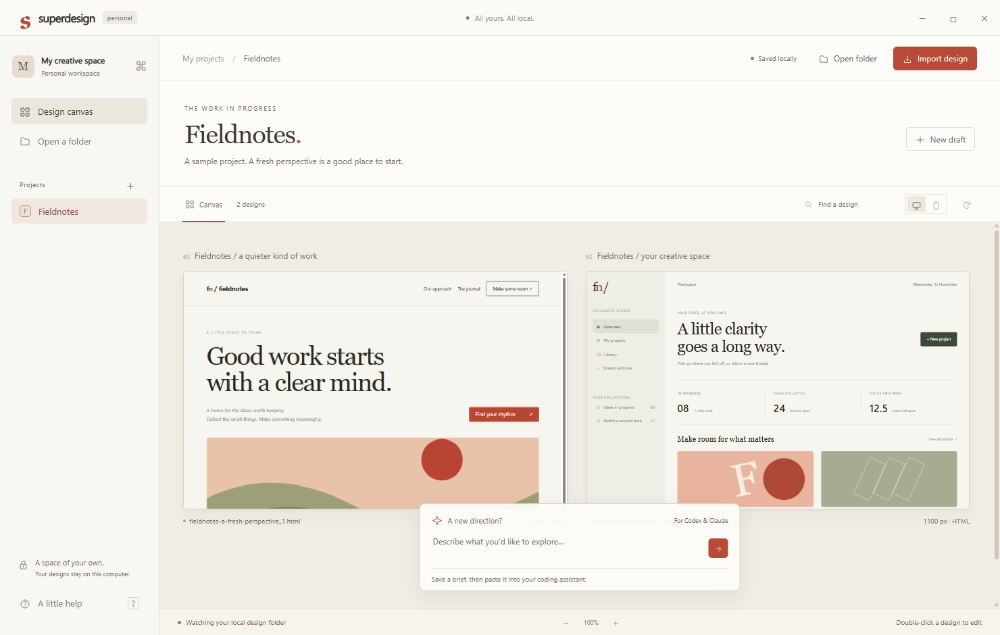

# Superdesign Personal

A standalone Windows design canvas inspired by the original Superdesign IDE extension. No Superdesign account, hosted canvas, API key, provider SDK or model service is used by this app. It makes no outbound requests at runtime.

Run `npm install`, `npx install-electron`, then `npm start` (Node 22.12 or newer). Run `npm run package` to build the portable Windows application under `release/Superdesign-Personal-win32-x64/`. Launch `Superdesign-Personal.exe` from that folder; keep its accompanying files together.

The app stores projects as normal local folders under Documents/Superdesign Personal. Open another project folder to watch its `.superdesign/design_iterations` directory. It imports HTML/SVG copies, watches external edits, creates local starter templates, edits source with preview, duplicates iterations, exports original source, and saves briefs for Codex or Claude. Previous editor saves are retained in `.superdesign/history`. Drafts modified externally are protected from stale editor overwrites.

Codex and Claude use the local `superdesign` skill to author designs in the watched folder. The app does not run an AI model or pretend its starter templates are AI generation. A coding assistant's own model/network requirements are separate from this local app.

Previews disable scripts and remote resources. Use self-contained HTML with inline CSS, SVG and data images; external assets are not downloaded or embedded automatically. Imported source and exported files are preserved without the preview restrictions. The desktop application blocks HTTP, HTTPS and WebSocket requests, denies permissions, and does not expose Node APIs to designs.

## Attribution and source

Original repository: https://github.com/superdesigndev/superdesign, pinned at `49e2b9dd9615c6dae936b326b1ddb85d4f1d6f19`, by AI Jason and JackJack. The original source is retained in this checkout. This standalone edition reimplements its local file-canvas workflow; it does not run the original VS Code host or provider integrations. No Enterprise-marked source was used. The original license is preserved in `../LICENSE` and bundled as `LICENSE.upstream.txt`; this edition's source is provided under AGPL-3.0-only. It is a personal adaptation, not an official Superdesign product.

DSI design workflow: Design Taste, explicit bundled/offline mode, library source `73743fc9eb9b51667f4a8698f195841d6915249a` plus maintenance overlay `dsi-0.1.23`. REA static inspection covered the original extension and canvas entrypoints; it did not claim complete runtime reconstruction. App runtime validation is recorded separately in evidence.

## Validation

`npm test` exercises persistence, unique iteration names, history, stale-save rejection, path boundaries, size limits, external discovery and saved briefs. `npm run test:ui` runs the native Electron UI with an isolated temporary workspace. Set `SUPERDESIGN_PACKAGED=1` to exercise the packaged executable. The UI check includes import/export with native file-dialog selections stubbed to test files, network denial, isolated previews, and unsaved-close protection. Screenshots and verification JSON are written under `evidence/`.

